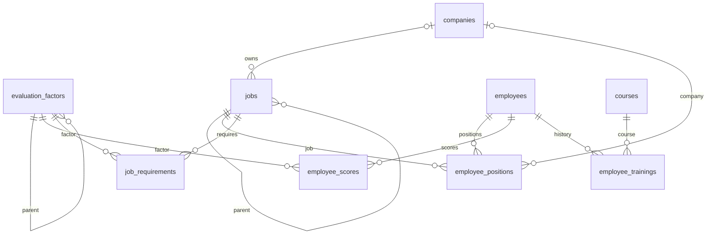

# Web application

سامانه ثبت شایستگی کارکنان و شرایط احراز مشاغل، با Java 27 و Spring Boot.

## Run

پیش‌نیازها: JDK 27، Maven و PostgreSQL. خروجی `mvn -version` باید Java 27 را نشان دهد.
در IntelliJ، گزینهٔ Maven → Runner → JRE نیز باید همان JDK پروژه باشد.
پیش از اجرا، رمز کاربر دیتابیس را در بخش Run → Edit Configurations → Environment variables
با نام `APP_DB_PASSWORD` وارد کنید. تنظیمات اتصال در بخش پایگاه داده توضیح داده شده‌اند.

```shell
mvn spring-boot:run
```

برنامه روی `http://127.0.0.1:8080` باز می‌شود. سرور به‌صورت پیش‌فرض فقط روی همین دستگاه در دسترس است.
رابط فارسی و راست‌به‌چپ است و به نصب Node.js یا دریافت فایل از CDN نیاز ندارد.

### اجرا از منوی Run در IntelliJ

دو تنظیم اجرا در پوشهٔ `.run` قرار دارند و از **Run → Run…** قابل انتخاب‌اند:

- `webapp - Run (Maven)`: کامپایل و اجرای برنامه با `spring-boot:run`.
- `webapp - Build (Maven)`: ساخت فایل JAR و اجرای آزمون‌ها با `verify`.

این تنظیم‌ها از SDK ثبت‌شده با نام `openjdk-27` استفاده می‌کنند. اگر نام JDK شما متفاوت است،
در **Run → Edit Configurations → Runner → JRE** همان JDK 27 را انتخاب کنید.
متغیرهای محیطی اتصال دیتابیس را در تنظیم اجرای `webapp - Run (Maven)` وارد کنید.
پیش از اجرا، نمونهٔ قبلی برنامه روی پورت ۸۰۸۰ را متوقف کنید.

اگر IntelliJ 2023.3 هنگام اجرای تنظیم `WebApplication` خطای `JDK 0` می‌دهد،
تنظیم `webapp - Run (Maven)` را انتخاب کنید؛ این مسیر کامپایل را به Maven می‌سپارد.
گزینهٔ **Before launch → Build** را به این تنظیم‌های Maven اضافه نکنید، چون کامپایل داخلی IDE را دوباره فعال می‌کند.
اگر تنظیم‌ها در فهرست ظاهر نشدند، پروژه را ببندید و دوباره باز کنید.

```shell
mvn verify
java -jar target/webapp-0.0.1-SNAPSHOT.jar
```

## امکانات مرحلهٔ اول

- تعریف عوامل ارزشیابی و مشاغل به‌شکل سلسله‌مراتبی، با چند ریشه و چند سطح.
- تعریف شرکت‌ها با کد یکتا، نام و توضیحات.
- تعریف هر شغل در یک شرکت، انتخاب بالادست از همان شرکت و فیلتر ساختار مشاغل بر اساس شرکت.
- ثبت مشخصات کارمند، مدرک تحصیلی و تاریخ شروع به کار شمسی.
- ثبت چند سمت برای هر کارمند در یک یا چند شرکت، از بخش «سمت‌ها در شرکت‌ها» در پروندهٔ کارمند.
- تعریف دوره، برگزارکننده و مدت آموزش.
- ثبت دوره‌های گذرانده‌شده، تاریخ پایان، نمرهٔ اختیاری و شماره گواهی در پرونده کارمند.
- ثبت دستی یک نمرهٔ جاری برای هر ترکیب کارمند و عامل.
- مشاهده، ثبت، ویرایش و حذف شرایط احراز از دکمهٔ «شرایط احراز» در ردیف هر شغل؛ شغل در فرم به‌صورت خودکار تعیین می‌شود.
- ثبت، ویرایش، حذف، جست‌وجو، صفحه‌بندی و فیلتر سوابق بر اساس کارمند یا شغل.
- نمایش نمرات و سوابق آموزشی در پروندهٔ کارمند.

برای مدیریت شرایط احراز به «ساختار مشاغل» بروید و در ردیف شغل موردنظر روی «شرایط احراز» کلیک کنید.
در این پنجره فقط عوامل و حداقل نمرات همان شغل نمایش داده می‌شوند. پس از ذخیره یا حذف، فهرست همان‌جا به‌روز می‌شود.

برای ثبت سمت، ابتدا شرکت و شغل را تعریف کنید، سپس به «کارمندان ← پرونده ← ثبت سمت» بروید.
سمت شامل شرکت، شغل و یادداشت اختیاری است. یک کارمند می‌تواند در یک شرکت چند شغل متفاوت داشته باشد.
در فرم سمت، پس از انتخاب شرکت فقط مشاغل همان شرکت نمایش داده می‌شوند.
شغل‌های قبلی خودکار به سمت تبدیل می‌شوند؛ شرکت آن‌ها تا زمان ویرایش با عنوان «شرکت مشخص نشده» نمایش داده می‌شود.

برای تعیین شرکت مشاغل قبلی، در «ساختار مشاغل» گزینهٔ «شرکت مشخص نشده» را فیلتر کنید و از ریشه به زیرمجموعه‌ها پیش بروید.
در migration شمارهٔ ۶، مشاغل، سلسله‌مراتب، شرایط احراز و سمت‌های قبلی حفظ می‌شوند و شرکتی به‌صورت حدسی به آن‌ها اختصاص نمی‌یابد.
ستون `jobs.company_id` فقط برای این داده‌های قدیمی خالی می‌ماند؛ در ثبت و ویرایش شغل، انتخاب شرکت الزامی است.
پیش از استفاده از شغل قدیمی در سمت جدید، شرکت آن را تعیین کنید. سمت‌های قدیمی که شرکتشان خالی است نیز از پرونده تکمیل می‌شوند.

## ورود کارمندان از اکسل

در صفحهٔ «کارمندان»، دکمهٔ **ورود از اکسل** را بزنید و قالب نمونه را دریافت کنید.
برگهٔ اول قالب برای اطلاعات کارمندان خالی است؛ نمونه‌ها و توضیحات در برگهٔ «راهنما» قرار دارند.
کد پرسنلی، نام و نام خانوادگی الزامی‌اند. مدرک تحصیلی، تاریخ شروع به کار شمسی و توضیحات اختیاری‌اند.
کد پرسنلی و تاریخ را به صورت Text وارد کنید؛ تاریخ نمونه `۱۴۰۳/۰۱/۰۱` است.

فایل‌های `.xlsx` و `.xls` تا ۵ مگابایت و ۱۰۰۰ ردیف اطلاعات پذیرفته می‌شوند.
عنوان ستون‌ها در ردیف اول باشد؛ فقط برگهٔ اول خوانده می‌شود و ردیف‌های خالی نادیده گرفته می‌شوند.
فایل بدون رمز و مقدار سلول‌ها بدون فرمول باشد. ستون‌های ناشناخته یا داده‌های بدون عنوان رد می‌شوند.

ابتدا **بررسی فایل و پیش‌نمایش** را بزنید. خطاها با شمارهٔ ردیف اکسل نمایش داده می‌شوند.
کد پرسنلی تکراری در فایل یا موجود در سامانه خطاست؛ این قابلیت فقط کارمند جدید می‌سازد و اطلاعات قبلی را بازنویسی نمی‌کند.
پس از رفع همهٔ خطاها، **تأیید و ثبت کارمندان** همهٔ ردیف‌ها را در یک تراکنش ذخیره می‌کند؛ خطای هر ردیف مانع ثبت کل فایل است.
ثبت نهایی دوباره با وضعیت فعلی دیتابیس اعتبارسنجی می‌شود. شرکت و سمت‌های هر فرد را پس از ورود، در پروندهٔ او ثبت کنید.

قالب قابل دریافت از `/templates/employees-import.xlsx` است؛ سازندهٔ آن `scripts/build_employee_import_template.py` است و به openpyxl نیاز دارد.
APIهای این قابلیت: `POST /api/employees/import/preview` برای بررسی و `POST /api/employees/import` برای ثبت؛ هر دو فایل را در فیلد multipart با نام `file` می‌گیرند.

## قواعد داده

نمره‌ها از صفر تا صد، با حداکثر دو رقم اعشار هستند. صفر با «ثبت‌نشده» تفاوت دارد.
ارقام فارسی و عربی در ورودی نمره و مدت دوره پذیرفته می‌شوند.
کد هر شرکت، عامل، شغل و دوره و کد پرسنلی کارمند یکتا است.
ترکیب کارمند/شرکت/شغل یکتا است؛ حذف سمت به نمرات و سوابق آموزشی کارمند دست نمی‌زند.
ترکیب کارمند/عامل و شغل/عامل یکتا است؛ تغییر نمره با ویرایش انجام می‌شود.
گذراندن دوبارهٔ یک دوره در تاریخ دیگر مجاز است؛ کارمند/دوره/تاریخ تکراری پذیرفته نمی‌شود.
تاریخ شروع به کار در ورودی، بانک اطلاعات و خروجی API شمسی است؛ در فرم مثلاً `۱۴۰۳/۰۱/۰۱` وارد کنید.
ستون `employees.start_date` از نوع `VARCHAR(10)` و قالب ذخیره و خروجی API آن `yyyy-MM-dd` با ارقام انگلیسی است (مثلاً `1403-01-01`).
ارقام فارسی و عربی، جداکنندهٔ `/` یا `-`، و ماه و روز یک‌رقمی هم پذیرفته و استاندارد می‌شوند.
سال شمسی از ۰۰۰۱ تا ۱۹۹۹ و روزهای معتبر هر ماه، با کنترل سال کبیسه، پذیرفته می‌شوند؛ تاریخ خالی مجاز است.
تاریخ‌های میلادی قبلی با migration شمارهٔ ۴ فقط یک بار به شمسی تبدیل می‌شوند؛ مقادیر خالی حفظ می‌شوند.
تاریخ پایان دوره و ارزشیابی همچنان ورودی و ذخیرهٔ میلادی و نمایش شمسی دارند و نمی‌توانند در آینده باشند.
حذف رکورد وابسته مسدود می‌شود و حذف آبشاری وجود ندارد.
انتخاب خود یا زیرمجموعه به‌عنوان والد، در رابط و سرور کنترل می‌شود.
شغل و بالادست آن باید متعلق به یک شرکت باشند. تغییر شرکت شغل نباید با شرکت سمت‌ها و زیرمجموعه‌های ثبت‌شده تعارض داشته باشد.
اگر یک شغل قدیمی در چند شرکت استفاده شده است، ابتدا مشاغل جداگانهٔ هر شرکت را بسازید و سمت‌های مربوط را اصلاح کنید.

این مرحله محاسبهٔ تطابق، وزن‌دهی، ارث‌بری شرایط احراز، تاریخچه نمره‌ها و ورود کاربران/سطوح دسترسی را شامل نمی‌شود.
هر عامل در هر سطح می‌تواند مستقیماً نمره یا شرط احراز داشته باشد؛ نمرهٔ والد از فرزندان محاسبه نمی‌شود.
آموزش‌ها نیز به‌صورت خودکار نمرهٔ شایستگی را تغییر نمی‌دهند.

## پایگاه داده و نگهداری

پایگاه دادهٔ اصلی PostgreSQL است و اتصال پیش‌فرض به `jdbc:postgresql://localhost:5433/Competency` انجام می‌شود.
نام کاربری پیش‌فرض `postgres` است؛ رمز باید با متغیر محیطی `APP_DB_PASSWORD` تنظیم شود.
نام دیتابیس در آدرس باید دقیقاً با نام ثبت‌شده در PostgreSQL یکسان باشد؛ در این پروژه `Competency` است.
جدول‌ها در اولین اجرا با Flyway ساخته می‌شوند. تغییرات بعدی باید با migration جدید اعمال شوند.
دیتابیس و کاربر باید از قبل موجود باشند و کاربر اجازهٔ ساخت و تغییر جدول‌ها در schema مورد استفاده را داشته باشد.
این اتصال از یک دیتابیس جدید استفاده می‌کند و سوابق فایل H2 قبلی وارد PostgreSQL نمی‌شوند.
برای پشتیبان‌گیری از PostgreSQL از ابزار Backup در pgAdmin یا `pg_dump` استفاده کنید.

متغیرهای اتصال: `APP_DB_URL`، `APP_DB_USERNAME` و `APP_DB_PASSWORD`.
اگر سرور، پورت یا نام کاربری متفاوت است، این مقادیر را در تنظیمات اجرای IntelliJ تغییر دهید؛
مثلاً `APP_DB_URL=jdbc:postgresql://localhost:5432/Competency` برای سروری روی پورت ۵۴۳۲.
رمز واقعی را در فایل‌های تحت کنترل Git ثبت نکنید.
تست‌ها از H2 حافظه‌ای با حالت سازگاری PostgreSQL استفاده می‌کنند و به اطلاعات واقعی دست نمی‌زنند.

| جدول | محتوا و ارتباط |
| --- | --- |
| `evaluation_factors` | کد، عنوان، توضیحات، والد از همین جدول |
| `jobs` | کد، عنوان، شرکت، توضیحات، شغل بالادست از همان شرکت |
| `companies` | کد یکتا، نام شرکت، توضیحات |
| `employees` | کد پرسنلی، نام، نام خانوادگی، مدرک تحصیلی، تاریخ شروع به کار شمسی، توضیحات |
| `employee_positions` | کارمند، شرکت، شغل، یادداشت؛ ترکیب کارمند/شرکت/شغل یکتا |
| `courses` | کد، عنوان، برگزارکننده، مدت به ساعت، توضیحات |
| `employee_trainings` | کارمند، دوره، تاریخ پایان، نمره اختیاری، گواهی، یادداشت |
| `employee_scores` | کارمند، عامل، نمره جاری، تاریخ ارزشیابی، یادداشت |
| `job_requirements` | شغل، عامل، حداقل نمره، یادداشت |

تعریف جدول‌ها و تغییرات: `src/main/resources/db/migration` و migration جاوای تبدیل تاریخ در `src/main/java/db/migration`.



## API

برای هر مسیر از `GET /api/{resource}` جهت فهرست، `POST /api/{resource}` جهت ثبت،
`PUT /api/{resource}/{id}` جهت ویرایش کامل و `DELETE /api/{resource}/{id}` جهت حذف استفاده کنید.
مسیرها: `companies`، `positions`، `factors`، `jobs`، `employees`، `courses`، `trainings`، `scores` و `requirements`.
فیلد `jobId` کارمند با ارتباط `positions` جایگزین شده است؛ ثبت و ویرایش سمت به `employeeId`، `companyId` و `jobId` نیاز دارد.
در `POST /api/jobs` و `PUT /api/jobs/{id}`، فیلد `companyId` الزامی است. `parentId` اختیاری و باید متعلق به همان شرکت باشد.
در `positions`، شرکت ارسال‌شده باید با شرکت شغل مطابقت داشته باشد.
`GET /api/summary` تعداد رکوردهای هر بخش را برمی‌گرداند.
نام فیلدهای JSON در `Requests.java` تعریف شده و به‌صورت camelCase است.
ورودی نامعتبر پاسخ ۴۰۰، رکورد ناموجود ۴۰۴ و تکرار یا نقض وابستگی پاسخ ۴۰۹ دارد؛ پیام‌ها فارسی هستند.

## آزمون‌ها

`mvn verify` ساخت و آزمون‌های HTTP را اجرا می‌کند: گردش کامل ثبت/ویرایش/حذف،
درخت‌ها، جلوگیری از چرخه، نمره و دقت اعشار، فیلد الزامی، تاریخ آینده، تکرار، روابط و فایل‌های رابط،
چند سمت در چند شرکت، اعتبارسنجی تاریخ شمسی و تبدیل تاریخ‌ها و سمت‌های قبلی بدون از دست رفتن اطلاعات.

آزمون اختیاری ماندگاری H2 پس از قطع ناگهانی (نیازمند Node.js 18 یا بالاتر؛ این آزمون PostgreSQL را بررسی نمی‌کند):
ابتدا `mvn verify` و سپس `node scripts/verify-persistence.mjs` را با JAVA_HOME نسخهٔ ۲۷ اجرا کنید.
این آزمون دو اجرای جداگانه در پوشه‌ای موقت زیر `target` ایجاد می‌کند و به دادهٔ اصلی دست نمی‌زند.
# CatalogService


